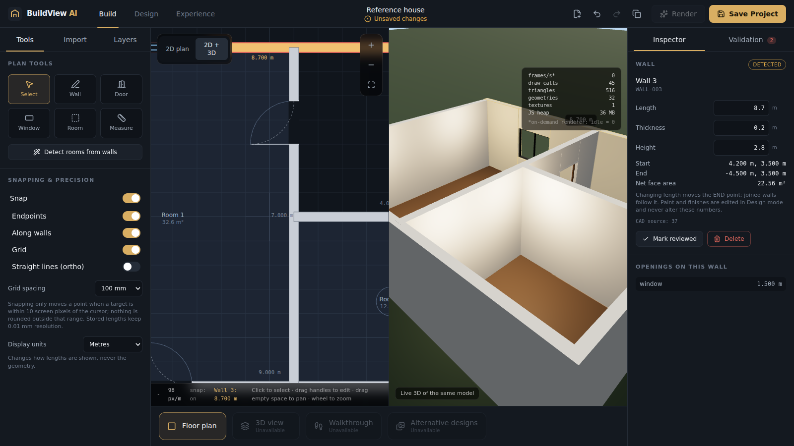

# BuildView AI

Architectural visualisation and design platform: import a DXF drawing, verify it as an editable 2D floor plan, generate a
synchronised 3D house, customise interiors, and walk through it.



| | |
| --- | --- |
| **Build** | DXF import, unit confirmation, layer mapping, 2D plan editor, validation, approval |
| **Design** | Paint, finishes, floors/ceilings, furniture, lighting on the generated house (the Prompt 1 studio) |
| **Experience** | First-person walkthrough with wall collision |

What works, what does not, and the evidence: **[docs/implementation-status.md](docs/implementation-status.md)**.
DWG is **not** supported (needs a licensed converter); DXF is. Recognition has only been validated on synthetic reference drawings.

## Stack

React 19 · TypeScript (strict) · Vite · Three.js / React Three Fiber · Tailwind 4 · Zustand · Zod · Fastify · PostgreSQL + Prisma ·
**Python 3 · FastAPI · ezdxf** (CAD worker) · Vitest · React Testing Library · pytest · Playwright · ESLint.

## Layout

```text
apps/web          React editor (plan editor, 3D studio, import wizard)
apps/api          Fastify API, Prisma schema + migrations, upload/import service
apps/cad-worker   Python FastAPI + ezdxf DXF parser (sandboxed worker process)
packages/shared          Zod schemas and types (building document v2, CAD/import/API contracts)
packages/geometry-engine Pure geometry: walls+openings, topology, recognition, validation, units, collision
packages/design-engine   Pure document operations, plan editing, snapping, history, sample, v1->v2 migration
packages/ui              UI kit
tests/fixtures    Reference DXFs + golden parse results     tests/e2e  Playwright workflows
docs/             architecture, cad-import, design-system, status, roadmap, screenshots
```

## Requirements

- Node.js ≥ 20.19 (developed on 22), npm 10+
- Python ≥ 3.12 and [`uv`](https://docs.astral.sh/uv/) for the CAD worker (`pip` + `venv` work too; see `apps/cad-worker/requirements.txt`)
- No Docker or system PostgreSQL needed: `npm run db:up` runs real PostgreSQL via the `embedded-postgres` package.

## Setup

```bash
npm install
cp .env.example .env
npm run worker:setup        # creates apps/cad-worker/.venv and installs ezdxf, FastAPI, pytest
npm run db:up               # terminal 1: PostgreSQL on :54329 (Ctrl+C to stop; data in .data/)
npm run db:generate         # Prisma client
npm run db:migrate          # apply migrations (terminal 2)
npm run dev                 # API :4000, web :5173, CAD worker :8100
```

Open http://localhost:5173. The first start creates a project; use the folder icon in the top bar for *New blank project*.

### Try the import

Build mode → **Import** tab → choose `tests/fixtures/dxf/house-gap.dxf` → *Confirm units* → check the layer table → *Apply to plan*.
The Validation tab shows one critical issue (a 300 mm gap in the north wall). Select that wall and drag its loose end onto the corner,
mark the elements reviewed, then **Approve & generate 3D house**.

### Local development modes (nothing is faked)

- `STORAGE=memory npm run dev -w @buildview/api`: in-memory repository, labelled with a banner, not persistent.
- API unreachable: the web app loads the sample read-only; saving fails visibly.
- CAD worker not running: uploads are stored but jobs fail with `worker_unreachable` and can be retried; `/api/health` reports `dxf: false`.

## Commands

| Command | |
| --- | --- |
| `npm run dev` | API + web + CAD worker |
| `npm run typecheck` · `npm run lint` | strict TS for every workspace and tests; ESLint |
| `npm test` | Vitest (all packages; API tests also run against PostgreSQL and the real worker when available) and pytest |
| `npm run test:e2e` | Playwright (starts API/web/worker if not running) |
| `npm run check` | typecheck + lint + tests |
| `npm run screenshots` | regenerate `docs/screenshots` |
| `npm run -w @buildview/cad-worker fixtures` | regenerate the reference DXFs and golden parse JSON |

### Playwright on a minimal Linux/WSL image

If Chromium fails with `libnspr4.so: cannot open shared object file` and you have no root:

```bash
mkdir -p ~/pwlibs/debs && cd ~/pwlibs/debs && apt download libnspr4 libnss3 libasound2t64
for d in *.deb; do dpkg -x "$d" ~/pwlibs/root; done
export LD_LIBRARY_PATH=$HOME/pwlibs/root/usr/lib/x86_64-linux-gnu:$LD_LIBRARY_PATH
```

(With root, `npx playwright install --with-deps chromium`.) WebGL in tests uses SwiftShader, so no GPU is required.

## Using it

- **Plan tools** (Build): `V` select · `W` wall · `D` door · `N` window · `R` room · `M` measure. Shift = straight lines. Wheel zoom, drag empty space to pan.
  Drag a wall endpoint, a wall body, or a door along its wall. Numbers in the Inspector accept the current display unit (e.g. `13' 1 1/2"`).
- **3D** (Design): click walls/floors/furniture; Shift-click extends wall selection; `Ctrl+Z`/`Ctrl+Shift+Z` undo/redo, `Ctrl+S` save.
- **Walkthrough** (Experience): `W A S D`, arrows to turn, drag to look.

## Documentation

[Architecture](docs/architecture.md) · [CAD import](docs/cad-import.md) · [Design system](docs/design-system.md) ·
[Implementation status](docs/implementation-status.md) · [Roadmap](docs/roadmap.md)
