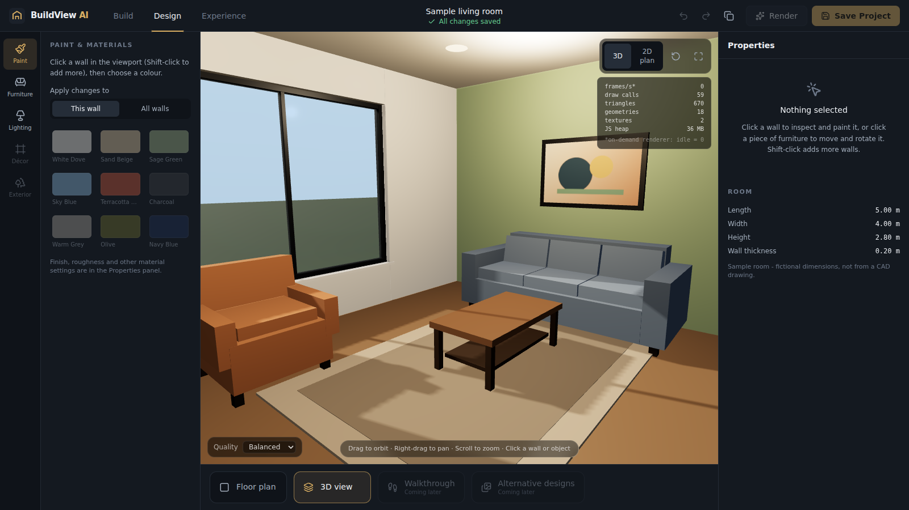

# BuildView AI

Professional architectural visualization and interior design platform. **Prompt 1 scope:** the software
foundation plus a genuinely working interactive 3D interior studio (paintable walls, editable furniture,
lighting, undo/redo and PostgreSQL-backed save/reload).



More screenshots: [docs/screenshots](docs/screenshots). What is and is not built:
[docs/implementation-status.md](docs/implementation-status.md).

## Stack

React 19 + TypeScript (strict) · Vite · Three.js / React Three Fiber / Drei · Tailwind CSS 4 · Zustand ·
Node.js + Fastify · PostgreSQL + Prisma · Zod · Vitest + React Testing Library · Playwright · ESLint.

## Repository layout

```
apps/web                 Vite + React editor (UI, R3F scene, editor state)
apps/api                 Fastify API, Prisma schema + migrations, repositories
packages/shared          Zod schemas and types: the scene-document contract, API contracts, presets
packages/geometry-engine Pure geometry: wall boxes with openings, furniture footprint/collision checks
packages/design-engine   Pure document operations, undo/redo history, sample room
packages/ui              Small UI kit (buttons, sliders, swatches, ...)
public-assets/           Reserved for optimised models / textures / HDRIs (currently empty - all assets are procedural)
tests/e2e                Playwright workflows
docs/                    architecture, design system, status, roadmap
```

## Requirements

- Node.js >= 20.19 (developed on 22) and npm 10+
- No Docker or system PostgreSQL needed: `npm run db:up` runs real PostgreSQL via the `embedded-postgres` package.
  You can instead point `DATABASE_URL` at any PostgreSQL 14+ server.

## Setup

```bash
npm install
cp .env.example .env          # DATABASE_URL points at the embedded PostgreSQL below
npm run db:up                 # terminal 1: starts PostgreSQL on :54329 (Ctrl+C to stop; data kept in .data/)
npm run db:generate           # generate the Prisma client
npm run db:migrate            # apply migrations (terminal 2)
npm run dev                   # starts API (:4000) and web (:5173)
```

Open http://localhost:5173. On first launch the app creates a sample project through the API.

### Local development mode (no database)

`STORAGE=memory npm run dev -w @buildview/api` runs the API with an in-memory repository. The UI shows a
yellow **"Local development storage"** banner because nothing survives an API restart. If the API itself is
unreachable the web app loads the sample room read-only: it shows a red banner and **Save fails visibly** -
it never pretends to have saved.

## Commands

| Command | What it does |
| --- | --- |
| `npm run dev` | API + web in watch mode |
| `npm run typecheck` | `tsc` for every workspace and for tests/scripts |
| `npm run lint` | ESLint (typescript-eslint, react-hooks) |
| `npm test` | Vitest for every workspace (API tests also run against PostgreSQL when `DATABASE_URL` is reachable) |
| `npm run test:e2e` | Playwright against the running API + web (starts them if needed) |
| `npm run check` | typecheck + lint + unit tests |
| `npm run screenshots` | regenerate `docs/screenshots` |
| `npm run db:migrate` | `prisma migrate deploy` |

### Playwright on a minimal Linux/WSL image

`npx playwright install chromium` downloads the browser. If it fails to start with
`libnspr4.so: cannot open shared object file` and you have no root access, extract the three missing
packages locally and expose them:

```bash
mkdir -p ~/pwlibs/debs && cd ~/pwlibs/debs && apt download libnspr4 libnss3 libasound2t64
for d in *.deb; do dpkg -x "$d" ~/pwlibs/root; done
export LD_LIBRARY_PATH=$HOME/pwlibs/root/usr/lib/x86_64-linux-gnu:$LD_LIBRARY_PATH
```

(With root, `npx playwright install --with-deps chromium` does this for you.) WebGL in tests uses SwiftShader,
so no GPU is required.

## Using the studio

- **Orbit** left-drag, **pan** right-drag, **zoom** wheel. **Reset camera** and **Fit room** (top right), **3D / 2D plan** toggle (also in the bottom strip).
- **Click a wall** to select it (Shift-click adds walls). Paint it from the Properties panel or the Paint tool; choose to apply to this wall, the selected group, or all walls.
- **Click furniture** to select, **drag** to move along the floor, `R` / buttons to rotate, `Delete` to remove optional items (restorable from the Furniture tool).
- **Lighting** tool: Daylight / Warm evening, ambient and sun intensity, interior lights.
- `Ctrl+Z`, `Ctrl+Shift+Z` / `Ctrl+Y` undo/redo, `Ctrl+S` save, `Esc` deselect.

## Documentation

- [Architecture](docs/architecture.md)
- [Design system](docs/design-system.md)
- [Implementation status](docs/implementation-status.md) - completed vs. incomplete, with test evidence
- [Roadmap / Prompt 2 recommendations](docs/roadmap.md)
